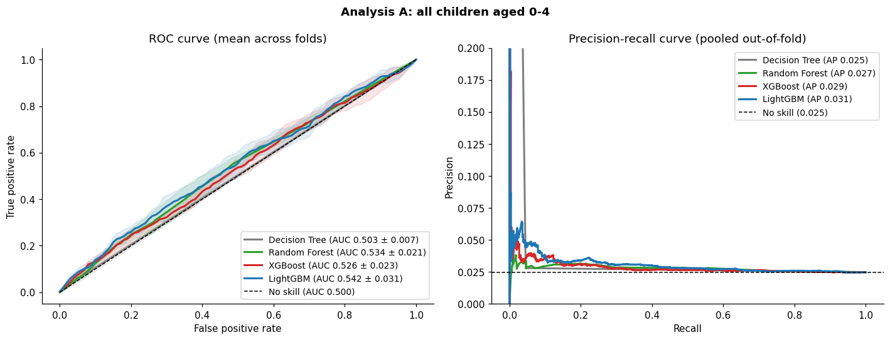
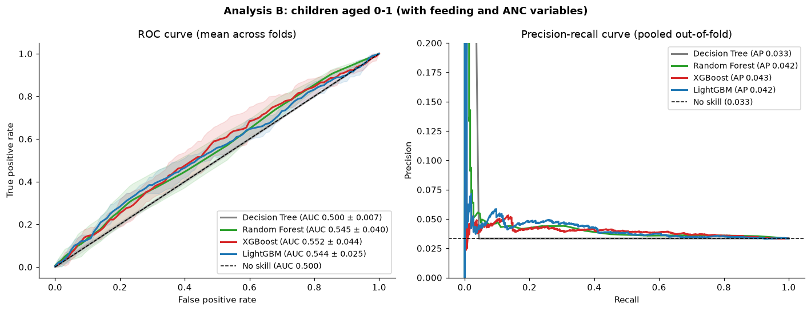
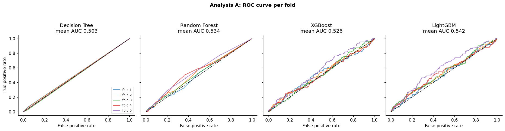
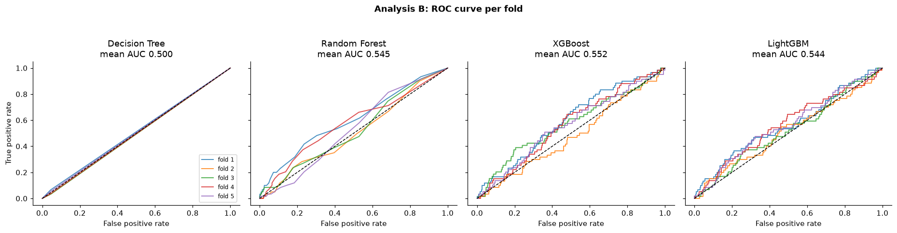
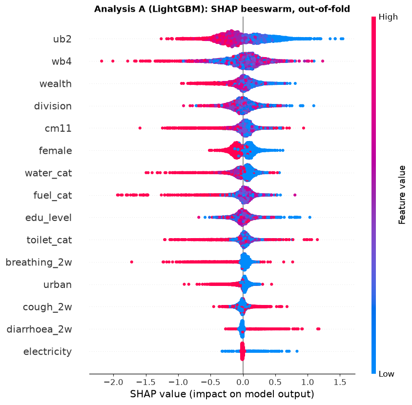
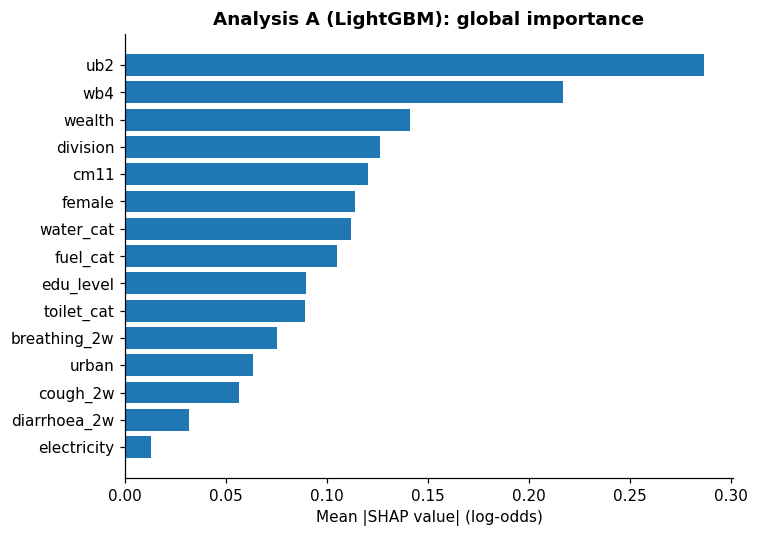
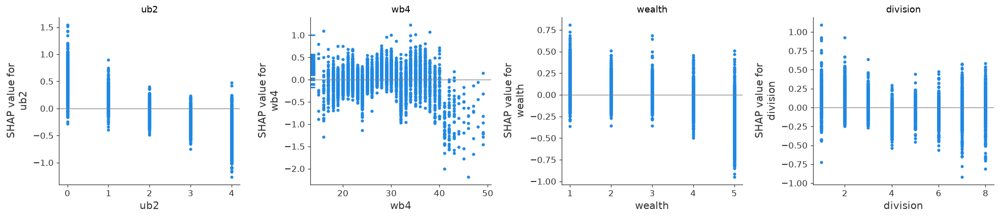
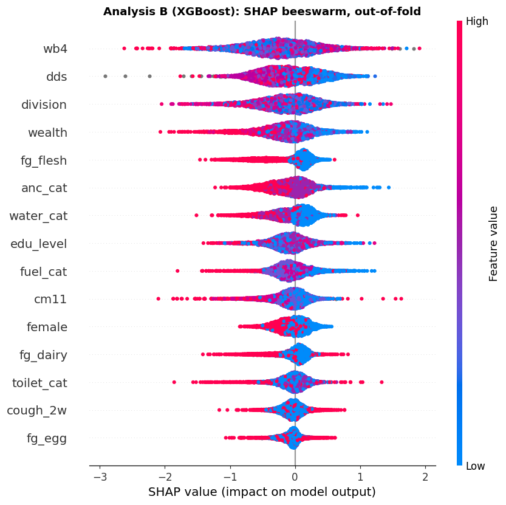
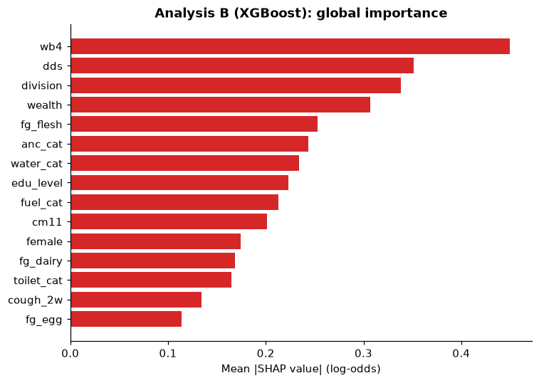
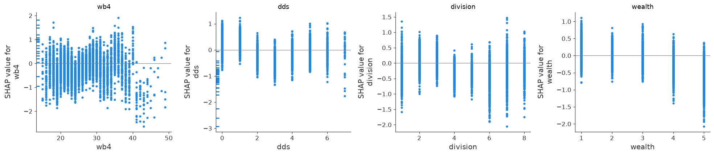

# Tree-Based Prediction and SHAP Results

Results from [`models.ipynb`](models.ipynb): four tree-based classifiers with **default (untuned) settings**, 5-fold cross-validation, ROC AUC and ROC curves, reference checks, a fair nested-CV comparison with tuned models and logistic regression, then SHAP explanations. The outcome is `severe_wasting` (WHZ < -3; 2.47% of 22,311 children).

## Bottom line

- **Prediction is weak, with or without tuning.** Raw default models reach a mean cross-validated ROC AUC of 0.542 (all children) and 0.552 (children aged 0-1), against 0.500 for chance, and overfit heavily (training AUC 0.97-1.00). In a fair nested comparison with tuning, the best models reach a weighted out-of-fold AUC of about 0.58-0.59 (all children) and 0.57-0.60 (children aged 0-1), and cluster-bootstrap intervals overlap heavily.
- **Trees do not beat simple logistic regression.** For all children, no tuned tree model is significantly better than the survey-weighted logistic regression, and age + sex alone scores as well (0.587). Only under 2 do the diet, ANC and household variables add a little (tuned Random Forest 0.595, +0.025 over weighted logistic, borderline).
- **Models are over-confident.** Calibration slopes are 0.3-0.8 for the complex models; only age + sex is well calibrated. The Brier score is no better than predicting the average prevalence.
- **SHAP agrees with the survey analysis on the main drivers:** child age, sex, wealth, and (in children under 2) diet and antenatal care. It also ranks maternal age and some household variables high, which the inference did not support and which probably reflects overfitting.
- These are associations learned by weak models on cross-sectional data; they are not causal effects.

## What was done

| Item | Choice |
|---|---|
| Models | `DecisionTreeClassifier`, `RandomForestClassifier`, `XGBClassifier`, `LGBMClassifier`, all with default hyperparameters |
| Settings changed | Only `random_state=42`, `n_jobs=2` and silent logging (for a low-end laptop) |
| Cross-validation | Stratified group 5-fold, grouped by PSU (`hh1`), so no PSU is in both training and test folds; every child is predicted once, out of fold |
| Analysis A | All children aged 0-4: 22,311 children, 552 cases, 17 predictors (no feeding variables) |
| Analysis B | Children aged 0-1 (under 2): 8,888 children, 297 cases, 28 predictors (adds dietary diversity, the 7 food groups, breastfeeding, bottle feeding, ANC) |
| Excluded | Outcome-derived columns (`whz2`, `mod_wasting`, `any_wasting`, `wast_cat`); identifiers and design variables; duplicates of other predictors (`young`, `any_illness`, `mage_cat`, `parity_cat`, `fvs`, `bd9`) |
| Missing values | Left as they are; the tree models handle them natively, so no rows are dropped |
| Weights | Models are trained unweighted (prediction in this sample) |
| SHAP | `TreeExplainer`, out of fold: the best model is refitted on each training fold and explained on 1,000 held-out children per fold (5,000 children) |

The raw-model part of the notebook (cross-validation, reference checks, SHAP) ran in about 4 minutes on a single CPU core with 4 GB of RAM; the nested tuning and bootstrap section adds several more minutes.

## Cross-validated prediction results (raw, untuned models)

Values are mean ± SD across the 5 folds. No-skill references: ROC AUC 0.500, PR AUC = prevalence (0.025 in A, 0.033 in B), Brier 0.024 (A) and 0.032 (B), top-10% capture 0.100.

### Analysis A: all children aged 0-4

| Model | ROC AUC | PR AUC | Brier | Top-10% capture | Train ROC AUC | Fit time (s) |
|---|---|---|---|---|---|---|
| LightGBM | 0.542 ± 0.031 | 0.033 ± 0.005 | 0.025 ± 0.000 | 0.138 ± 0.012 | 0.966 ± 0.005 | 0.2 |
| Random Forest | 0.534 ± 0.021 | 0.028 ± 0.001 | 0.026 ± 0.000 | 0.121 ± 0.010 | 1.000 ± 0.000 | 1.1 |
| XGBoost | 0.526 ± 0.023 | 0.032 ± 0.006 | 0.025 ± 0.000 | 0.131 ± 0.027 | 0.984 ± 0.003 | 0.5 |
| Decision Tree | 0.503 ± 0.007 | 0.025 ± 0.001 | 0.062 ± 0.004 | 0.114 ± 0.032 | 1.000 ± 0.000 | 0.1 |

### Analysis B: children aged 0-1

| Model | ROC AUC | PR AUC | Brier | Top-10% capture | Train ROC AUC | Fit time (s) |
|---|---|---|---|---|---|---|
| XGBoost | 0.552 ± 0.044 | 0.045 ± 0.012 | 0.035 ± 0.001 | 0.145 ± 0.039 | 1.000 ± 0.000 | 0.4 |
| Random Forest | 0.545 ± 0.040 | 0.051 ± 0.018 | 0.034 ± 0.001 | 0.134 ± 0.059 | 1.000 ± 0.000 | 0.6 |
| LightGBM | 0.544 ± 0.025 | 0.047 ± 0.008 | 0.033 ± 0.000 | 0.128 ± 0.025 | 0.998 ± 0.001 | 0.1 |
| Decision Tree | 0.500 ± 0.007 | 0.034 ± 0.001 | 0.074 ± 0.002 | 0.115 ± 0.041 | 1.000 ± 0.000 | 0.0 |

How to read the table:

- **Train ROC AUC** near 1.00 with test AUC near 0.50 shows overfitting. Fully grown default trees memorise the training children.
- **Top-10% capture** is the share of a fold's cases found among the 10% of children with the highest predicted risk. 10% is chance; the best models reach 13.8% (A) and 14.5% (B).
- The default **Decision Tree** is no better than chance and has a much worse Brier score because its predicted probabilities are almost all 0 or 1.

### ROC and precision-recall curves




The ROC curves of all models hug the diagonal. Per-fold curves (fold-to-fold variability, which is large, especially in B with only about 60 cases per fold):




### Reference checks

Cross-validated logistic regression with the same folds (reference only, not one of the four requested models):

| analysis | reference model | ROC AUC |
|---|---|---|
| A: all children | Logistic regression: ub2 | 0.584 ± 0.025 |
| A: all children | Logistic regression: ub2 + female | 0.588 ± 0.025 |
| B: ages 0-1 | Logistic regression: ub2 | 0.542 ± 0.032 |
| B: ages 0-1 | Logistic regression: ub2 + female | 0.555 ± 0.040 |

Label-permutation test (50 shuffles of the outcome; best model in each analysis):

| analysis | best model | observed mean AUC | chance mean AUC | chance SD | chance max | permutation p-value |
|---|---|---|---|---|---|---|
| A: all children | LightGBM | 0.542 | 0.499 | 0.016 | 0.533 | 0.02 |
| B: ages 0-1 | XGBoost | 0.552 | 0.497 | 0.026 | 0.563 | 0.039 |

In Analysis A the best model beats all 50 shuffled runs (largest chance AUC 0.533, p = 0.020); in Analysis B one shuffled run scored higher (largest chance AUC 0.563, p = 0.039). Both are above chance, but the margin is small.

## Fair comparison: tuned models vs logistic regression (nested cross-validation)

The raw-model results above compare untuned trees fitted on the raw columns. A second, like-for-like comparison was added to `models.ipynb`: every model uses the same children, the same outer PSU-grouped folds, and identical preprocessing (imputation and one-hot encoding inside each training fold). Compared are logistic regression with age and sex only, full unweighted logistic regression, full survey-weighted logistic regression (the reference), a more strongly regularised weighted logistic regression, and **tuned** Decision Tree, Random Forest, XGBoost and LightGBM. Tree hyperparameters are tuned only inside each outer training fold (3-fold PSU-grouped inner CV, small random search), so the outer test fold is never used for tuning. Weighted models use `chweight` as a predictive sample weight; this is not design-based inference. Confidence intervals come from a cluster bootstrap that resamples whole PSUs (300 resamples). Weighted metrics are primary because the target is the population; the calibration slope should be near 1 (below 1 means over-confident predictions). The Brier score is about 0.0245 (A) and 0.032 (B) for every model including the no-skill baseline, so it is not shown.

### Analysis A: all children aged 0-4

| Model | Weighted ROC AUC (95% cluster-bootstrap CI) | Difference vs weighted logistic (95% CI) | Weighted PR AUC | Weighted top-10% capture | Calibration slope |
|---|---|---|---|---|---|
| Logistic: age + sex | 0.587 (0.558-0.613) | +0.006 (-0.017 to +0.030) | 0.035 | 0.187 | 0.93 |
| XGBoost (tuned) | 0.585 (0.557-0.614) | +0.005 (-0.009 to +0.018) | 0.035 | 0.195 | 0.68 |
| Random Forest (tuned) | 0.584 (0.555-0.614) | +0.004 (-0.014 to +0.019) | 0.036 | 0.184 | 0.78 |
| Logistic: regularized, weighted | 0.581 (0.553-0.610) | +0.000 (-0.004 to +0.005) | 0.035 | 0.169 | 0.66 |
| Logistic: full, unweighted | 0.581 (0.555-0.611) | +0.000 (-0.010 to +0.010) | 0.036 | 0.169 | 0.62 |
| Logistic: full, weighted (reference) | 0.580 (0.553-0.611) | (reference) | 0.035 | 0.171 | 0.57 |
| LightGBM (tuned) | 0.560 (0.532-0.588) | -0.020 (-0.041 to +0.001) | 0.033 | 0.164 | 0.33 |
| Decision Tree (tuned) | 0.555 (0.526-0.584) | -0.025 (-0.056 to +0.006) | 0.031 | 0.151 | 0.04 |
| Prevalence baseline (no skill) | 0.485 (0.457-0.509) | -0.095 (-0.135 to -0.055) | 0.024 | 0.101 | n/a |

### Analysis B: children aged 0-1

| Model | Weighted ROC AUC (95% cluster-bootstrap CI) | Difference vs weighted logistic (95% CI) | Weighted PR AUC | Weighted top-10% capture | Calibration slope |
|---|---|---|---|---|---|
| Random Forest (tuned) | 0.595 (0.557-0.634) | +0.025 (+0.000 to +0.052) | 0.046 | 0.156 | 0.79 |
| XGBoost (tuned) | 0.589 (0.554-0.628) | +0.019 (-0.003 to +0.049) | 0.045 | 0.154 | 0.50 |
| Logistic: regularized, weighted | 0.580 (0.545-0.615) | +0.010 (+0.003 to +0.018) | 0.042 | 0.115 | 0.54 |
| LightGBM (tuned) | 0.573 (0.541-0.613) | +0.003 (-0.029 to +0.034) | 0.042 | 0.146 | 0.29 |
| Logistic: full, weighted (reference) | 0.570 (0.533-0.605) | (reference) | 0.040 | 0.121 | 0.40 |
| Logistic: full, unweighted | 0.566 (0.530-0.604) | -0.004 (-0.020 to +0.014) | 0.042 | 0.132 | 0.41 |
| Logistic: age + sex | 0.548 (0.511-0.584) | -0.022 (-0.068 to +0.022) | 0.039 | 0.110 | 0.92 |
| Decision Tree (tuned) | 0.546 (0.506-0.584) | -0.024 (-0.062 to +0.018) | 0.040 | 0.150 | 0.03 |
| Prevalence baseline (no skill) | 0.488 (0.451-0.518) | -0.082 (-0.135 to -0.032) | 0.032 | 0.085 | n/a |

What the fair comparison shows:

- **All models cluster together.** For all children, the weighted out-of-fold ROC AUC is 0.58-0.59 for the logistic models, tuned Random Forest and tuned XGBoost, with confidence intervals about ±0.03 wide. No model is significantly better than the survey-weighted logistic regression, and **age + sex alone** has the nominally highest AUC (0.587). The extra predictors and the tree ensembles add no measurable discrimination for all children.
- **Tuning matters for the trees.** Unweighted pooled AUC rises from 0.534 to 0.582 (Random Forest), 0.526 to 0.580 (XGBoost) and 0.503 to 0.554 (Decision Tree) compared with the raw models. The selected settings are shallow and regularised (XGBoost depth 2 in all 5 folds; Random Forest depth 5-10; Decision Tree depth 3-5 in 4 of 5 folds), which fits a weak, simple signal. LightGBM improves less (0.542 to 0.559) and is nominally lower than the weighted logistic (-0.020, CI -0.041 to +0.001).
- **Under 2, extra variables add a little.** Tuned Random Forest is nominally best (0.595; +0.025 over weighted logistic, CI 0.000 to 0.052, borderline). The regularised logistic regression is slightly but consistently better than the unregularised one (+0.010, CI 0.003 to 0.018). Age + sex alone is lower here (0.548) than every model that includes the diet, ANC and household variables, so these variables add roughly 0.02-0.05 AUC (point estimates).
- **Discrimination is still modest.** AUC stays at or below 0.60. PR AUC is about 0.035 against a prevalence of 0.025 in A and 0.046 against 0.033 in B. The 10% of children with the highest predicted risk contain up to about 19% of cases in A for the best models (15-17% for the full logistic models) and about 15-16% in B for the tree models, compared with about 10% by chance.
- **Calibration is poor for the complex models.** The calibration slope is 0.57 for the full weighted logistic regression (A) and 0.40 (B), 0.68 and 0.50 for tuned XGBoost, 0.78 and 0.79 for tuned Random Forest, 0.33 and 0.29 for tuned LightGBM, and near 0 for the tuned Decision Tree. Only the age + sex model is well calibrated (0.93 and 0.92). Predicted probabilities from the complex models would need recalibration before any use.
- **The in-sample AUC was optimistic.** The full survey-weighted logistic regression scores 0.580 out of fold, against the 0.635 in-sample AUC reported in `eda.ipynb` for a similar model, an optimism of about 0.05.

Limitations: the weighted Python fit gives no design-based standard errors; the tuning budget is small and uses an unweighted inner AUC; the intervals are conditional on the out-of-fold predictions; and SHAP below was computed on the raw untuned models, not on these tuned ones.

## SHAP analysis

SHAP values are on the log-odds scale. The **share** column is each variable's share of the total mean |SHAP|; **direction** is the Spearman correlation between a variable's value and its SHAP value (positive = higher values raise predicted risk; negative = higher values lower it). For unordered codes (`division`, `water_cat`, `toilet_cat`, `fuel_cat`) the direction is not meaningful, because the code numbers have no order; read direction together with the plots.

### Analysis A: all children (LightGBM)

| rank | Variable | Meaning | mean abs SHAP | share of total | direction |
|---|---|---|---|---|---|
| 1 | ub2 | Age of child in completed years | 0.287 | 17.4% | -0.88 |
| 2 | wb4 | Age of mother/caretaker | 0.217 | 13.1% | +0.11 |
| 3 | wealth | Wealth index quintile | 0.141 | 8.6% | -0.61 |
| 4 | division | Division | 0.126 | 7.6% | -0.36 |
| 5 | cm11 | Total number of live births | 0.12 | 7.3% | -0.33 |
| 6 | female | Child is female | 0.114 | 6.9% | -0.79 |
| 7 | water_cat | Drinking water source | 0.112 | 6.8% | -0.67 |
| 8 | fuel_cat | Cookstove fuel category | 0.105 | 6.4% | +0.15 |
| 9 | edu_level | Mother/caretaker education | 0.089 | 5.4% | -0.06 |
| 10 | toilet_cat | Toilet type | 0.089 | 5.4% | -0.25 |





- **Child age** is the top predictor (17% of the total), with younger children pushed toward higher risk (direction -0.88). This matches the survey analysis (OR 0.80 per year).
- **Sex:** being female lowers predicted risk (direction -0.79), matching the survey analysis (OR 0.72).
- **Wealth and urban area:** higher wealth and urban residence lower predicted risk (directions -0.61 and -0.58). The survey models found only a weak wealth trend, so these variables may share information.
- **Recent illness:** cough and diarrhoea raise risk (directions +0.31, +0.34), in line with the univariate results.
- **Mother's age (`wb4`)** ranks second, but its direction is almost flat (+0.11) and the earlier inference found no clear maternal-age effect. It is a numeric variable with 35 distinct values, which tree models over-use when they overfit; treat it with caution.

### Analysis B: children aged 0-1 (XGBoost)

| rank | Variable | Meaning | mean abs SHAP | share of total | direction |
|---|---|---|---|---|---|
| 1 | wb4 | Age of mother/caretaker | 0.45 | 10.2% | +0.17 |
| 2 | dds | Dietary diversity score | 0.351 | 8.0% | -0.44 |
| 3 | division | Division | 0.338 | 7.6% | -0.31 |
| 4 | wealth | Wealth index quintile | 0.307 | 6.9% | -0.61 |
| 5 | fg_flesh | Ate flesh foods yesterday | 0.253 | 5.7% | -0.77 |
| 6 | anc_cat | ANC visits category | 0.243 | 5.5% | -0.63 |
| 7 | water_cat | Drinking water source | 0.234 | 5.3% | -0.70 |
| 8 | edu_level | Mother/caretaker education | 0.223 | 5.1% | -0.06 |
| 9 | fuel_cat | Cookstove fuel category | 0.213 | 4.8% | -0.17 |
| 10 | cm11 | Total number of live births | 0.201 | 4.6% | -0.42 |





SHAP importance by variable group (Analysis B):

| Group | Share of total mean \|SHAP\| |
|---|---|
| Household and maternal (wealth, division, water, fuel, toilet, education, mother's age, births, urban, etc.) | 51.2% |
| Diet (`dds` and the seven food groups) | 26.7% |
| Recent illness | 6.7% |
| Child age and sex | 6.5% |
| Antenatal care | 5.5% |
| Breastfeeding and bottle | 3.3% |

- **Dietary diversity (`dds`)** and **flesh foods (`fg_flesh`)** are among the leading predictors, with higher values lowering predicted risk (directions -0.44 and -0.77). **ANC** also lowers risk with more visits (-0.63). This agrees with the survey-based infant analysis, where `dds`, `fg_flesh` and ANC were the main infant signals.
- `dds` is the sum of the seven food-group indicators, so SHAP credit is shared between them; the 26.7% diet share is the more reliable summary than any single food variable.
- Breastfeeding status and bottle feeding contribute little (3.3% together), matching the survey analysis.
- In this subset child age has only two values (0 or 1), so its importance is small by construction.

## How to interpret the SHAP results

1. **The models are close to chance.** Raw out-of-fold AUC is 0.54-0.55 (tuned models reach only 0.58-0.60), so the SHAP values explain what these overfit models learned, not stable risk factors. Individual SHAP values reach ±1.5 to ±2 log-odds even though the models barely separate cases from non-cases, which is a sign of fitted noise.
2. **Agreement with the survey analysis** (age, sex, wealth, diet, ANC, illness direction) is the most trustworthy part of this output.
3. **Disagreement** (mother's age, fuel and water category, number of births) is more likely overfitting or proxying for geography and wealth than real signal.
4. **No causal claim** is supported: the data are cross-sectional, diet is a single 24-hour recall, and sick or wasted children may eat less.

## Limitations

- The SHAP analysis uses the raw untuned models, which overfit. Tuning raises AUC to about 0.58-0.60 but does not beat logistic regression, so SHAP on the tuned Random Forest or XGBoost (shallow, regularised) would be a useful repeat and may rank variables differently.
- Only about 60 cases per test fold in Analysis B, so fold-to-fold variation is large.
- SHAP was computed on a 5,000-child out-of-fold sample, not all children.
- Models are unweighted, so results describe this sample, not the national population.
- Integer-coded categories (division, water, fuel, toilet) are treated as ordered numbers by the trees.

## Files

| File | Content |
|---|---|
| [`models.ipynb`](models.ipynb) | The executed notebook: setup, cross-validation, ROC curves, reference checks, SHAP |
| `outputs/ml_cv_summary_*.csv`, `outputs/ml_cv_fold_metrics_*.csv` | Cross-validation summary and per-fold metrics for Analysis A (`all_children`) and B (`infants`) |
| `outputs/ml_reference_logistic.csv`, `outputs/ml_permutation_check.csv` | Reference logistic regression and permutation test |
| `outputs/fair_model_comparison_summary_*.csv` | Nested-CV pooled and fold-level metrics, weighted and unweighted, with calibration (`all_children`, `under2`) |
| `outputs/fair_model_comparison_cluster_bootstrap_*.csv` | Weighted AUC with PSU cluster-bootstrap intervals and paired differences vs weighted logistic |
| `outputs/fair_model_comparison_tuning_*.csv` | Hyperparameters chosen in each outer fold (inner-CV AUC) |
| `outputs/fair_model_comparison_fold_metrics_*.csv`, `outputs/fair_model_comparison_oof_predictions_*.csv` | Fold-level metrics and out-of-fold predictions |
| `outputs/ml_shap_importance_*.csv` | Mean absolute SHAP, share and direction for every variable |
| `figures/ml_*.png` | ROC/PR curves, per-fold ROC curves, SHAP beeswarm, bar and dependence plots |

## Run it on a low-end laptop

```bash
pip install pandas numpy scikit-learn xgboost lightgbm shap matplotlib scipy
jupyter nbconvert --to notebook --execute models.ipynb
```

Settings that control the load are at the top of the notebook: `N_JOBS = 2` (use 1 on a very slow machine), `N_SPLITS = 5` and `SHAP_N_PER_FOLD = 1000` (use 500 to halve the SHAP work). The raw-model part of the notebook (cross-validation, reference checks, SHAP) took about 4 minutes on one CPU core with 4 GB of RAM; the nested tuning and bootstrap section adds several more minutes because tuning is repeated inside every outer fold.
